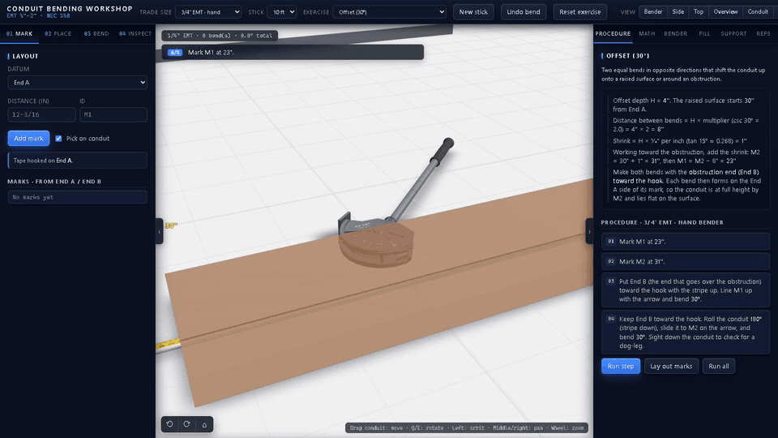
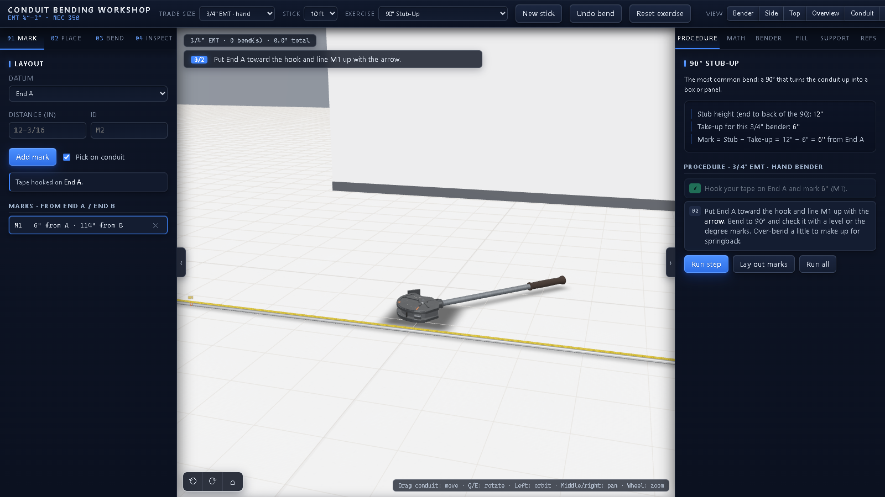
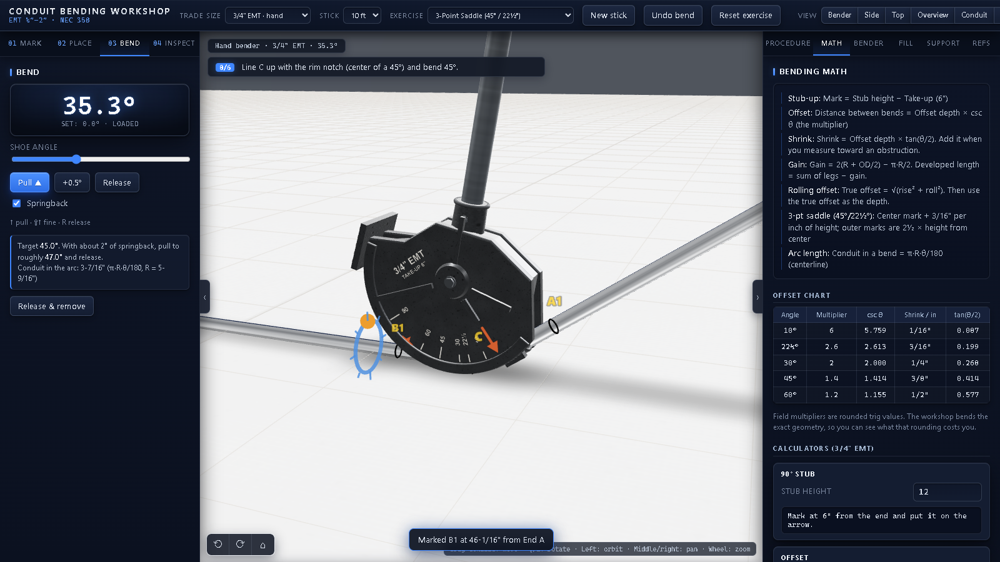
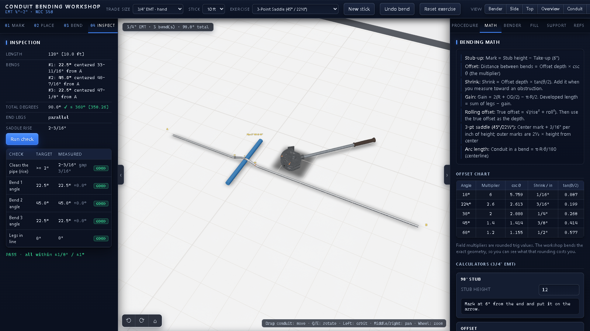
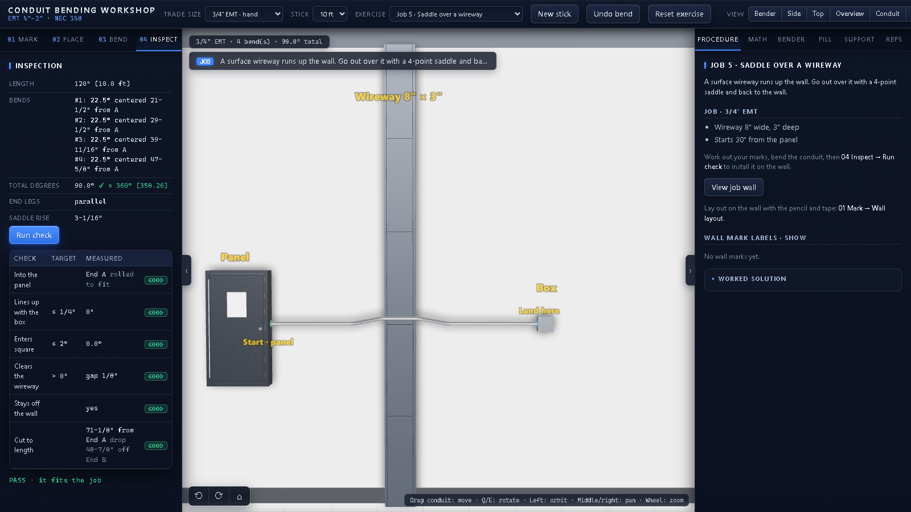
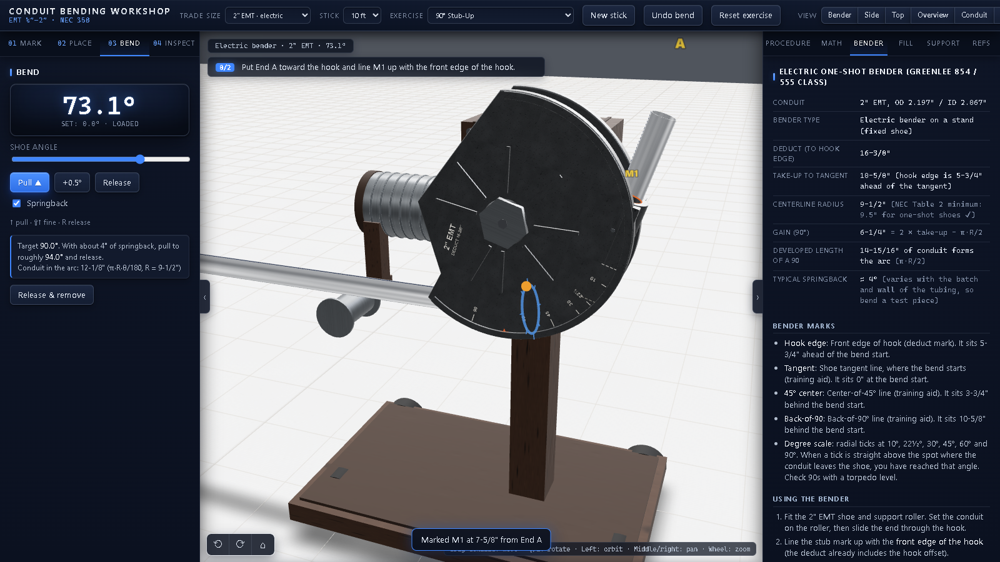
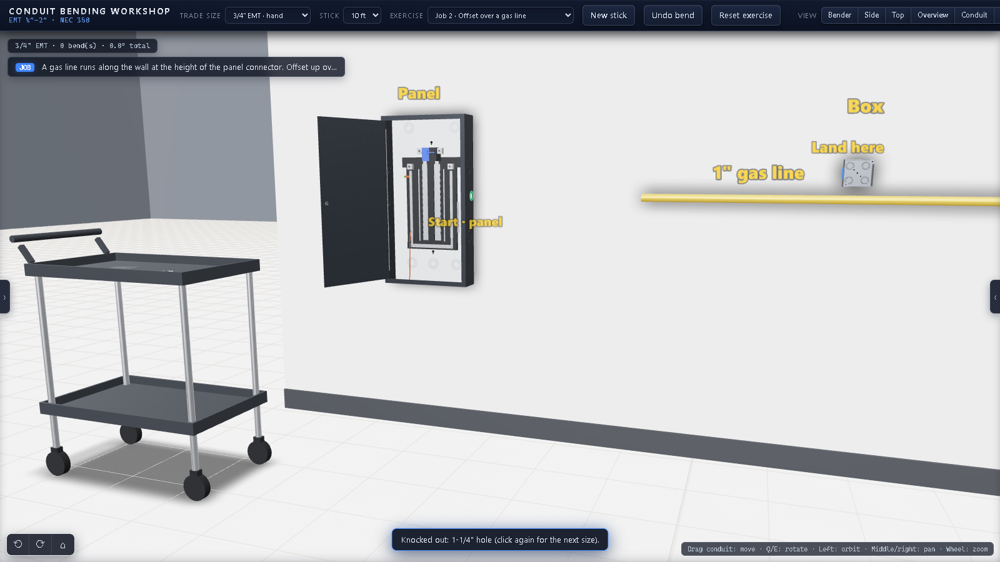

# Conduit Bending Workshop (3/4" – 2" EMT)

A 3D, browser-based training simulator for marking, placing and bending EMT conduit, then fitting it
to real field jobs on a work wall.

A 50-second tour. [Watch it as an MP4 (higher quality)](docs/media/tour.mp4).

## Screenshots

| | |
|---|---|
|  |  |
| **01 Mark**: hook the tape on an end and mark the stick. The hand bender lies on the floor beside it until you need it. | **03 Bend**: a 3-point saddle part-way through its center 45°, with the bending math and offset chart. |
|  |  |
| **04 Inspect**: the true measured geometry of the bent stick, graded against the lesson. | **Field job**: a 4-point saddle over a wireway, cut to length and installed panel to box. Every check passes. |
|  |  |
| **Electric bender**: 2" EMT on the one-shot bender, with deducts, gain and springback for that size. | **Job hardware**: open the panel door, punch concentric knockouts, and put the 4-square cover and screws on the cart. |

## Run it
1. Install the one dependency (Three.js) once: `npm install`
2. Double-click `start-workshop.bat` (needs Python), or run `python -m http.server 8123` in this folder,
   then open http://localhost:8123/.

After `npm install`, everything runs offline.

## What it does
- **3/4", 1", 1-1/4"**: floor hand bender. The bender rolls along the floor leg like the real thing.
  Arrow (take-up 6" / 8" / 11"), rim notch (center of 45°), star (back of 90°), degree scale.
- **1-1/2", 2"**: electric one-shot bender (Greenlee 854/555 class). Deducts are 14-7/8" / 16-3/8"
  to the hook edge, and the shoe radius follows NEC Ch. 9 Table 2.
- Workflow: **Mark** (tape from an end, the back of a 90, or a mark; or click the conduit) → **Place**
  (mark, reference, which end faces the hook, roll by the printed stripe, slide; a see-through bender
  previews the setup) → **Bend** (pull, springback, release) → **Inspect** (true measured geometry plus
  lesson grading).
- Lessons: 90° stub, back-to-back, 30° offset, 3-point saddle, 4-point saddle, free bending.
  "Run step" demonstrates each step; "Run all" does the whole exercise.
- **Field jobs**: six jobs on a job wall (panel up to an overhead box, offset over a gas line, offset
  onto a column, saddles over a water pipe and a wireway, up and over a door). Lay out on the wall with a
  pencil and tape, hold the bent stick up to the wall, set real-dimension connectors, cut it to length,
  and the check grades the fit.
- **Job hardware**: hinged panel with a modeled load-center interior, concentric knockouts on every
  side, a 4-square box whose screws and cover go onto a draggable work cart.
- **Moving things around**: drag the conduit or the bender across the floor, Alt+drag to raise or lower
  them, Q/E to turn them. A right-click menu switches between pencil and camera, views and panels.
- Info tabs: bending math and calculators, bender specs, NEC Chapter 9 conduit fill calculator,
  NEC 358 support rules with a strap planner, and sources.

The conduit is an exact centerline of straight legs and arcs at the shoe radius, so results such as
the 1/16" error from the 2.0 offset multiplier are real geometry, not canned answers.
`node test/lessons.test.mjs` replays every lesson for every size headlessly,
`node test/obstacles.test.mjs` checks that finished offsets and saddles never pass through their
obstruction, and `node test/routes.test.mjs` checks that every field job fits for every size.

Bender values vary by manufacturer: always check the chart on your own bender.
